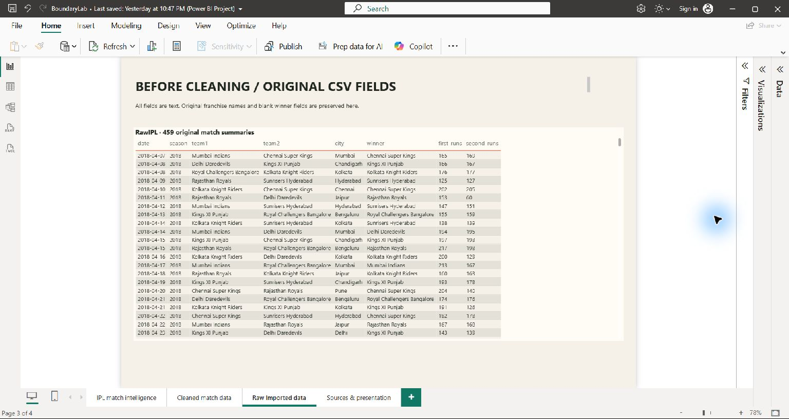
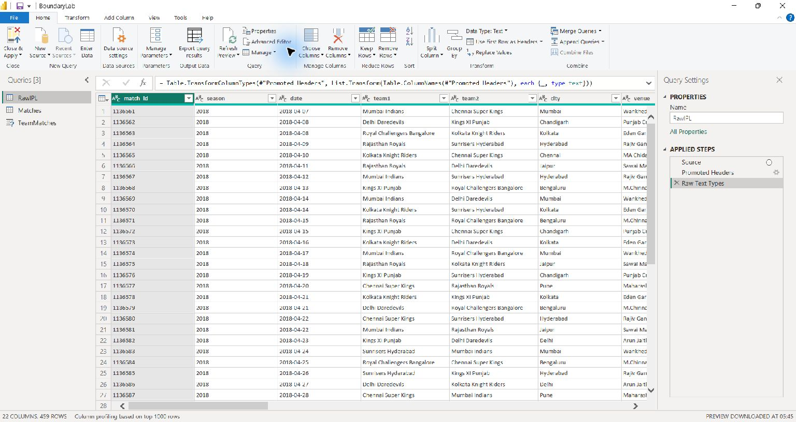
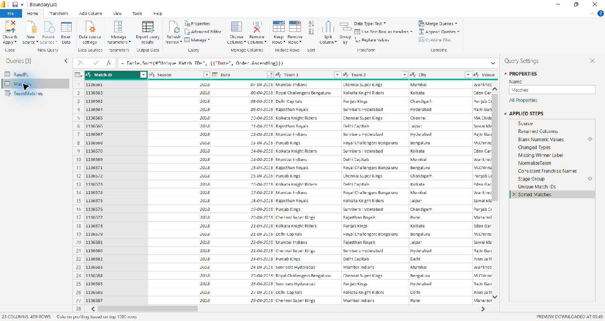
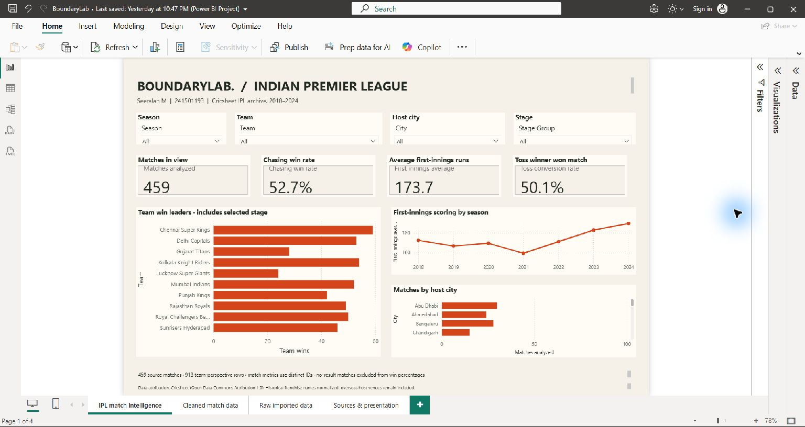
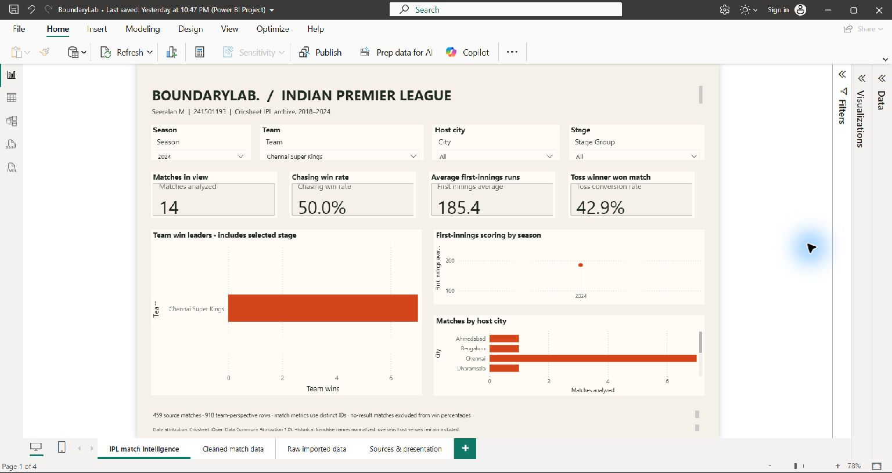
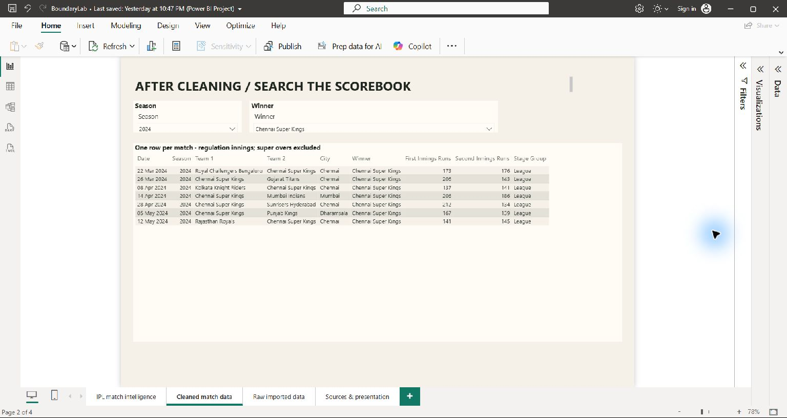
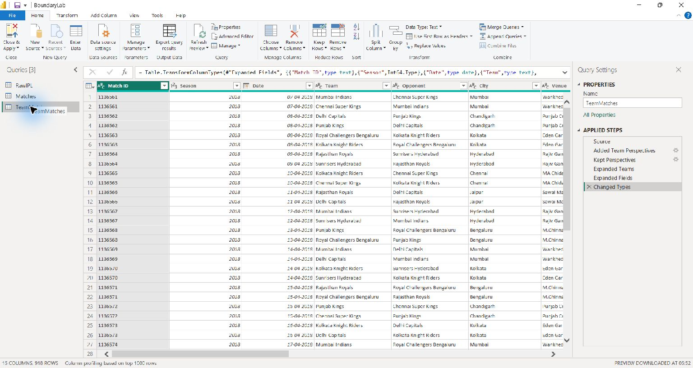
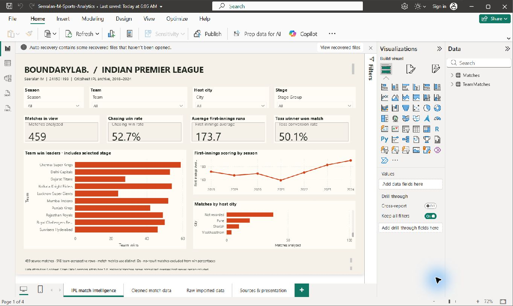

# BoundaryLab — Power BI Desktop Evidence

**Student:** Seeralan M  
**Reg no:** 241501193

This gallery shows the original data, Power Query cleanup, and dashboard states captured in Power BI Desktop.

## Original data

## Power Query before cleanup

## Power Query after cleanup

## Dashboard before slicer filters

## Dashboard after slicer filters

## Filtered records

## Derived team perspective

## Portable refresh

